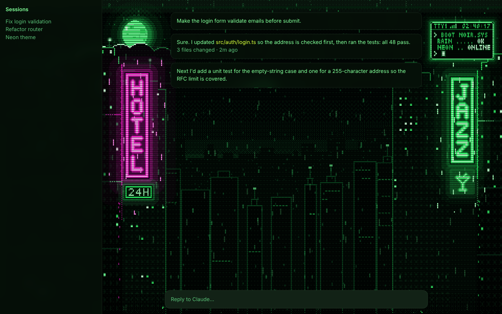

# Themx

Theme mods for the Claude apps.

| Mod | What it is |
| --- | --- |
| [Neon Noir Terminal](mods/neon-noir-terminal) | A dark, high-contrast green-phosphor terminal look, with an animated pixel-art noir city in the rain behind the conversation and a pixel detective above the prompt |



## Install

At the prompt of a Claude Code terminal session:

```
/plugin install neon-noir-terminal --marketplace tvo1898/Themx
```

Answer `y` to add the marketplace, then pick a scope. In the desktop app, where
`/plugin` does not run: click + next to the prompt box, then Plugins, Add
marketplace with `tvo1898/Themx`, then Add plugin.

## Layout

- `mods/<name>/`: each mod, ready to install.
- `design/<name>/`: the generators and checks that make a mod's palette and art.
- `.claude-plugin/marketplace.json`: the marketplace that lists the mods.
