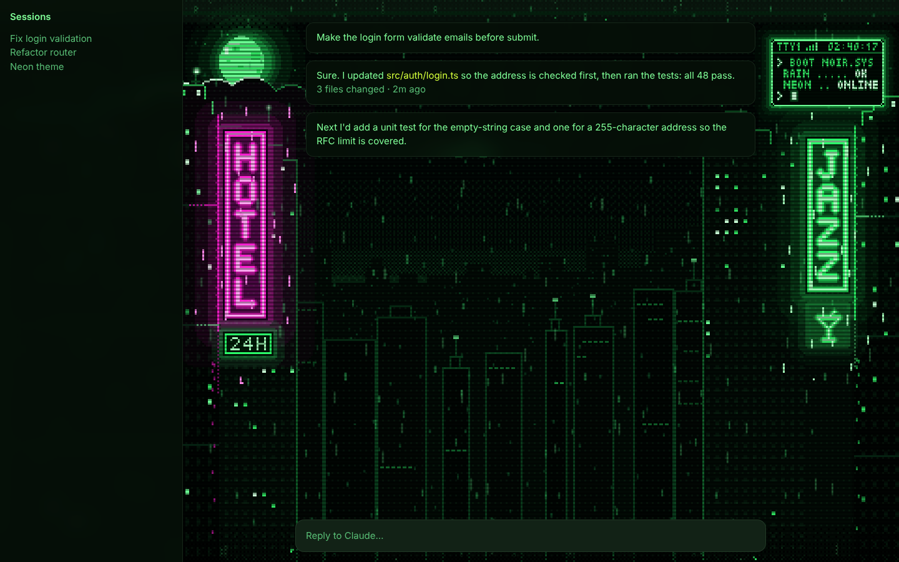
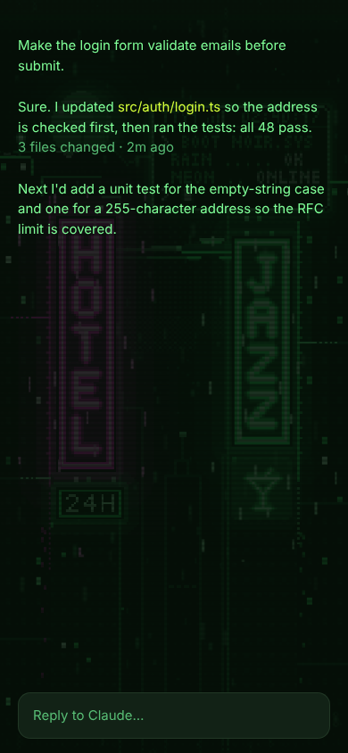
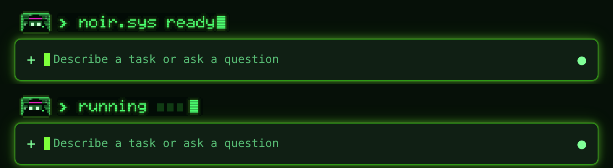

# Neon Noir Terminal

A theme mod for the Claude desktop and mobile apps. It's a dark, high-contrast
green-phosphor developer terminal, with a pixel-art noir city in the rain
behind the conversation, drawn as if on a CRT.



<p>
  
  
</p>

_Previews are mocks of the apps, drawn from the real scene and band._

## What it does

- **Palette, dark and high contrast.** Every surface, word, border and focus
  ring is repainted. Text is phosphor green in three steps: bright (15.4:1),
  normal (11.8:1) and dim (8.3:1, WCAG AAA). Borders and focus rings are
  strengthened (`contrast: 'more'`), and the focus ring glows hot green. Code
  stays readable by hue: lime keywords, aqua strings, magenta literals, coral
  names and amber variables, every one at 7:1 or better on every surface.
- **Animated backdrop.** A rain-soaked pixel city on a green CRT, with
  scanlines, a rolling scan band, a magenta HOTEL sign, a JAZZ sign, a
  scanline moon and passing hover-cars. A TTY window in the corner types a
  boot log, then keeps typing commands with a blinking block cursor. The art
  sits at the edges and top; the middle (your words) and the foot (the message
  box) stay quiet. Frosted panels sit over it at 86% opacity, so every word
  stays crisp.
- **Prompt band.** A pixel CRT-headed detective in a fedora sits above the
  prompt with a terminal line: `> noir.sys ready▮` while waiting, and
  `> running` with a pixel progress meter while Claude works.

## Commands

| Command | What it does |
| --- | --- |
| `/noir` or `/noir status` | What is set, and whether this app draws it |
| `/noir rain` | The animated look (the default) |
| `/noir still` | The same look, frozen |
| `/noir off` | Back to the app's own look |
| `/noir band off` / `/noir band on` | Hide or show the pixel band above the prompt |

Your choices are kept across sessions.

## Good to know

- **Use the app in dark mode.** The look is dark only. The mobile app follows
  it on its own. The desktop app doesn't yet follow a theme's color scheme, so
  set Desktop to dark (Settings → Appearance).
- **Fonts and text glow.** Claude's theme API sets colors and the backdrop.
  It can't change the app's typeface or add glow to its text, so the terminal
  feel comes from color, the CRT backdrop and the band.
- **Reduced motion.** With your system's reduce-motion setting on, the
  backdrop and band show a composed still, with the boot log fully typed.
  `/noir still` gives the same still on demand.
- **Photosensitivity.** Nothing flashes faster than three times a second. The
  fastest flicker, a neon sign's, is 1.5 times a second over a small patch,
  and no large bright area changes quickly.
- **Battery.** The rain moves across the whole window, which keeps the app
  redrawing. On battery, `/noir still` keeps the look and draws nothing new.
- **Layout.** The signs and the TTY are placed for the window's size, clear of
  the sidebar and the conversation. They're laid out for the sidebar open; with
  it closed, on windows 1280 to 1536 pixels wide, the conversation can cover
  part of a sign.
- **Where it draws.** The look draws in the Claude desktop and mobile apps.
  The terminal and the editors don't draw themes; there the mod only adds
  `/noir`.

## Install

At the prompt of a Claude Code terminal session:

```
/plugin install neon-noir-terminal --marketplace tvo1898/Themx
```

Answer `y` to add the marketplace, then pick a scope. In the desktop app,
where `/plugin` does not run: click + next to the prompt box, then Plugins,
Add marketplace with `tvo1898/Themx`, then Add plugin.

## How it's built

`hooks/register.tsx` is the whole mod:

- At `session.start` it sets the theme: `$.theme.set` with the palette, a
  backdrop scene and frosted glass.
- A `ui.render` hook on `Backdrop` draws the scene.
- A `ui.render` hook on `AbovePrompt` draws the band.
- `/noir` switches modes. Choices are kept in `$.store`, and in `$.state` so
  that the band redraws at once.

The art is plain SVG with CSS animation, baked into `hooks/scene.ts` and
`hooks/band.ts` by the generators in the repository's `design/` folder. The
palette is a handful of seed colors in `hooks/palette.ts`; `makeColors` (from
the design system, in `hooks/make-colors.js`) expands them into the app's
tokens.

```
claude plugin validate mods/neon-noir-terminal
claude plugin test mods/neon-noir-terminal
```
